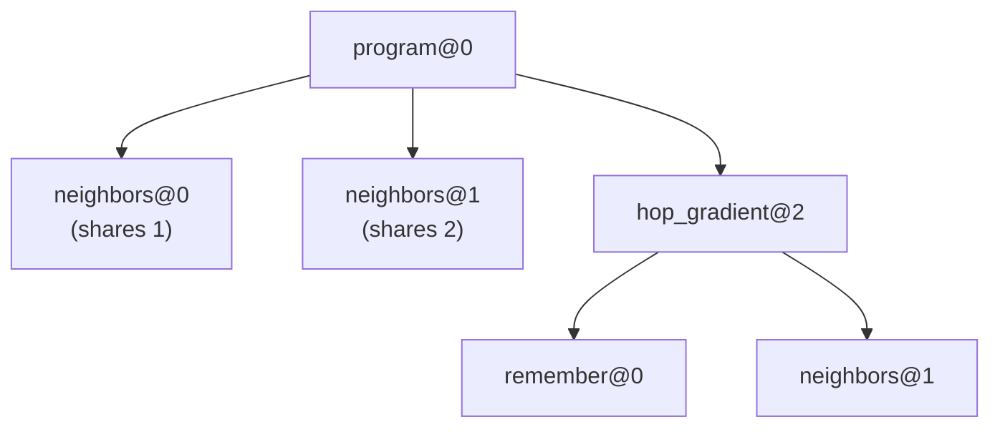
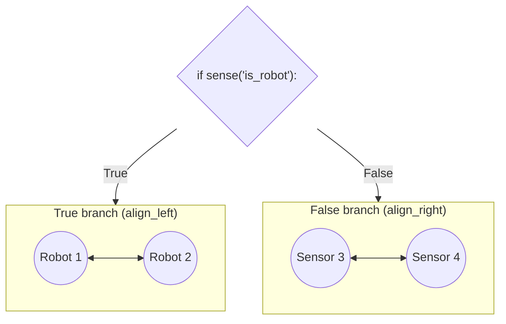

# Alignment and `@aggregate`

## What alignment is

When a device calls `neighbors(x)`, it does not receive *every* value its neighbors shared during their round: it only receives the values they shared **at the exact same point of the program**.

Matching these points across devices is called **alignment**, and it is what makes aggregate functions safely composable: two independent gradients in the same program never mix their messages.

**phyelds** identifies each point in the execution by its **call path**: the stack of `@aggregate` calls leading to it, tagged with each call's sequential index among its siblings:

```python
@aggregate
def program():
    a = neighbors(1)            # path: program@0 / neighbors@0
    b = neighbors(2)            # path: program@0 / neighbors@1
    return hop_gradient(False)  # path: program@0 / hop_gradient@2 / ...
```



The very same path also keys the local state of [`remember`](state.md) and [`exchange`](neighborhood-field.md#exchange).

---

## What `@aggregate` does: automatic network splitting

`@aggregate` marks a Python function as part of the aggregate computation. When the function runs, `@aggregate` does two things:

1. **Pushes the function onto the alignment path**, so all calls inside it are scoped under its name and call index.
2. **Rewrites `if` statements and conditional expressions** (`a if cond else b`) at the AST level so that the `True` branch and the `False` branch run under distinct alignment scopes (`align_left` vs `align_right`).

Because the two branches have different alignment paths:

- **Devices that take different branches do not see each other's messages**—the network is automatically partitioned into two isolated sub-networks (domains).
- **State inside a branch that is not taken is dropped** at the end of the round.



```python
@aggregate
def program():
    if sense("is_robot"):
        return neighbors("robot")      # (1)!
    else:
        return neighbors("sensor")     # (2)!
```

1. Path: `program@0 / align_left@0 / neighbors@0`. Only neighbors that also took the `True` branch appear in this `NeighborhoodField`.
2. Path: `program@0 / align_right@0 / neighbors@0`. Only neighbors that also took the `False` branch appear here.

The same automatic splitting applies to Python conditional expressions (`a if c else b`). This also keeps devices aligned for all calls *after* the conditional expression, even when only one branch communicates:

```python
@aggregate
def program():
    nearest = 0.0 if sense("source") else min(neighbors(estimate()))
    return nearest, neighbors(sense("id"))  # every device meets again here!
```

A conditional expression is rewritten only when at least one of its branches contains a function call, since a branch without calls cannot communicate or hold state.

!!! warning "When AST rewriting does not apply"
    - A helper function **without `@aggregate`** does not rewrite its `if` statements and does not push a frame onto the path. Always decorate functions that call aggregate primitives (directly or indirectly) with `@aggregate`.
    - A conditional expression containing `:=`, `yield`, or `await` cannot be lifted into a lambda and is left untouched.
    - See [Common pitfalls](../pitfalls.md) for details.

To inspect how `@aggregate` rewrites a function, call `str_transformed_code(fn)` or set the environment variable `PHYELDS_DEBUG_AST=1`:

```python
from phyelds.calculus import str_transformed_code
print(str_transformed_code(program))
```

Because AST rewriting inspects the function's source code, `@aggregate` functions must be defined in a `.py` file or a Jupyter notebook cell (if source code is unavailable, such as inside `exec`, phyelds logs a warning and runs the function un-rewritten).

---

## Explicit alignment with `align`

`align(name)` opens an aligned scope manually: values shared inside the `with align(name):` block are only exchanged with neighbors that entered an `align` block with the **same `name` at the same call position**.

```python
from phyelds.calculus import aggregate, align, neighbors

@aggregate
def per_team(team: str):
    with align(team):
        return sum(neighbors(1))   # counts only neighbors belonging to the same team
```

Because the sequential call position is still part of the path, `align` does **not** make a loop safe if different devices iterate a different number of times; for dynamic multi-instance computations, use [`@process` / `spawn`](../libraries/self-organisation.md#aggregate-processes-phyeldslibrariesprocesses) or see [Common pitfalls](../pitfalls.md#a-data-dependent-number-of-aggregate-calls).
