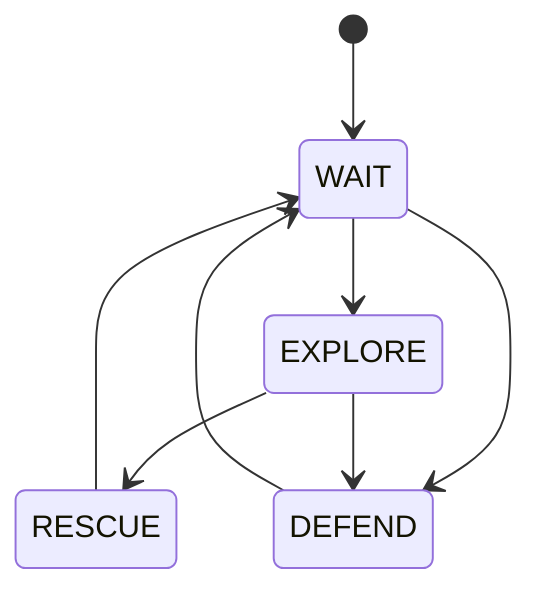

# Collective state machines

!!! warning "Experimental"
    This is a [study in progress](index.md): its API will probably change.

A collective state machine (cFSM) is a finite state machine run by a whole collective:
its states are collective behaviours (*explore*, *defend*), its transitions are
collective agreements. A device senses an event and proposes a transition; the network
makes it a decision of everyone. This module implements the model of [*Macroscopic
Design of Swarms with Collective State
Machines*](https://doi.org/10.1007/978-3-032-36868-3_28) (Aguzzi, Audrito, Girau,
Torta, Casadei, ICCCI 2026), whose experiments are [in
ScaFi](https://github.com/cric96/experiments-2025-collective-state-machines); the
definitions below are the paper's.

```python
from phyelds.experimental.state_machines import StateMachine
```

---

## Describing a machine

A `StateMachine` lists its states; each state is a function, which does what a device
does in that state and, from what happens, proposes where to go:

```python
mission = StateMachine("wait", "explore", "defend")

@mission.state("explore", to=["defend"])
def explore():
    velocity = sink_at(sense("leader"))               # what the drone does
    if sense("attack"):
        mission.go("defend", priority=math.inf)       # where the swarm should go
    return velocity

@aggregate
def drone():
    state, velocity = mission.run()
```

Here the drone moves with a [swarm behaviour](swarm.md); the
[example](swarm.md#example-a-mission) there is a mission whose phases are a machine.

- **States**: strings, numbers, or the members of an enum. The machine starts in the
  first one. Devices send the position of a state, not the state, so a long name costs
  nothing in the messages.
- **`@mission.state(name, to=[...])`**: the function of a state. It runs aligned on the
  state, so it can use `remember`, `neighbors` and the libraries on its own: a timer
  started in a state restarts when the machine enters it again. Decorate it with
  `@aggregate` too if it calls them in branches, as any other function. `to` lists the
  states it may go to: optional, but it lets the machine check them and draw itself.
- **`mission.go(state, priority=...)`**: from the function of a state, proposes a
  transition (see [priorities](#how-it-works) below). A function that does not call
  it stays.
- **`mission.run()`**: runs a round, and returns the state the device agreed on and
  what its function returned.
- **`mission.to_mermaid()`**: the diagram of the declared transitions.

---

## How it works

A history is the sequence of prioritised states `(priority, state)` the machine went
through, from the initial one (Definition 3). It never loops, but at its end: while the
machine stays in a state, the history ends with a *self-loop*, which records the
priority of staying. In every round, each device (Definition 6):

1. **Agrees.** It takes the maximum of the histories its neighbors sent, its own
   included: histories are compared lexicographically, each entry by priority, then by
   state, and a prefix is smaller (Definition 5). A transition spreads to the whole
   network, hop by hop.
2. **Acts.** It runs the program of the last state of that history, aligned on it.
3. **Extends.** It extends the history with the prioritised state the program produced:
   a final self-loop is replaced, any other entry is kept (Definition 4). It sends the
   result to its neighbors.

The program of a state produces the greatest of staying, with the lowest priority, and
of the transitions it proposes with `go` (Remark 1). Two devices can propose different
transitions at once: the histories diverge, and the first entry that differs decides,
the higher **priority** first, then the state **declared later**.

!!! note "Priorities"
    Staying has the lowest priority, and is recorded too: a transition with the same
    priority wins only if it goes to a later state. A transition to an earlier state
    needs a higher priority. The case study of the paper gives standard transitions the
    time they happen, negated, so that the earlier wins, and the urgent ones `math.inf`:

    ```python
    mission.go("wait", priority=-local_time())
    mission.go("defend", priority=math.inf)
    ```

---

## Example: a search-and-rescue mission

The case study of the paper, without the movement: a swarm of drones waits at the base
(bottom left), explores when an alarm goes off, rescues when a drone finds the target
(top right), and defends the base when it is attacked. Each event is sensed by one drone
only. In each phase, a drone also computes how far it is from where it heads: the base
or the target.



```python
--8<-- "mission.py:mission"
```

{ width="480" }
{ width="480" }

Blue is *wait*, orange *explore*, green *rescue*, red *defend*. The alarm at the base
spreads *explore*; then the base is attacked just as the target is found, and both
transitions spread from opposite corners: *defend* has the higher priority, and takes
over the drones that had moved to *rescue*. Once the base is safe, the swarm waits,
explores again, rescues the target, and waits.

The complete example is
[`docs/examples/mission.py`](https://github.com/phyelds/phyelds/blob/master/docs/examples/mission.py).

---

## A single transition function

`StateMachine` is built on `collective_state_machine(initial, transition)`, which takes
the whole machine as one function: given the state, it returns the next one, as a bare
state or as `Next(state, priority)`, and returns the state the device agreed on.

```python
from phyelds.experimental.state_machines import Next, collective_state_machine

def step(state):
    if state == "wait" and sense("attack"):
        return Next("defend", priority=math.inf)
    return state

state = collective_state_machine("wait", step)
```

Its states are sent as they are, and compared with `<` to settle conflicts of equal
priority.

---

## Compressed histories

A history grows with every transition, and so do the messages. With `window=`, each
device forgets the entries older than `window` time units, keeping at least two, and
counts those it forgot (Definition 7, Section 3.1):

```python
mission = StateMachine("wait", "explore", "defend", window=60.0)
```

Each entry records when its state was entered, on an approximately shared clock: the
`time` sensor (`local_time()`), or the `clock` given to `run`. To take the maximum, the
histories are aligned on their forgotten entries: a history smaller than another at
their first incompatible entry is dropped, and the others are merged (Definition 8). If
the window is longer than the time a message takes to cross the network, the machine
behaves as with the whole history.
