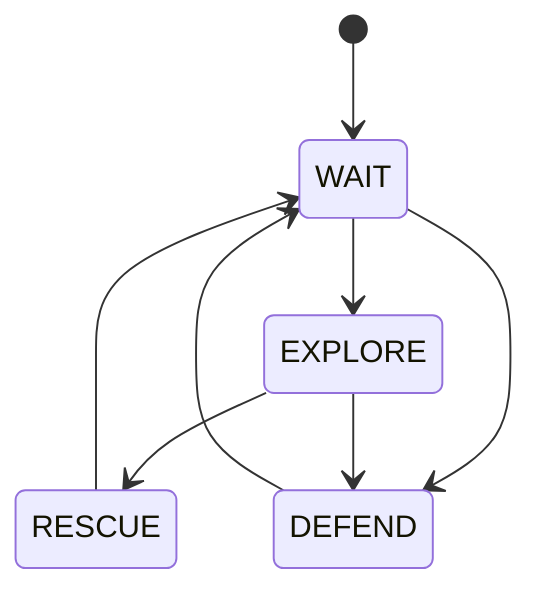

# Collective state machines

!!! warning "Experimental"
    This is a [study in progress](index.md): its API will probably change.

A collective state machine is a finite state machine run by a whole collective: its
states are collective behaviours (*explore*, *defend*), its transitions are collective
agreements. A device senses an event and proposes a transition; the network makes it a
decision of everyone. It comes from the paper *Macroscopic Design of Swarms with
Collective State Machines*, and from [its experiments in
ScaFi](https://github.com/cric96/experiments-2025-collective-state-machines).

```python
from phyelds.experimental.state_machines import StateMachine
```

---

## Describing a machine

A `StateMachine` lists its states; each state is a function, which does what a device
does in that state and, from what happens, proposes where to go:

```python
mission = StateMachine("wait", "explore", "defend")

@mission.state("explore", to=["defend"])
def explore():
    velocity = flock()                                # what the drone does
    if sense("attack"):
        mission.go("defend", priority=math.inf)       # where the swarm should go
    return velocity

@aggregate
def drone():
    state, velocity = mission.run()
```

- **States**: strings, numbers, or the members of an enum. The machine starts in the
  first one. Devices send the position of a state, not the state, so a long name costs
  nothing in the messages.
- **`@mission.state(name, to=[...])`**: the function of a state. It runs aligned on the
  state, so it can use `remember`, `neighbors` and the libraries on its own: a timer
  started in a state restarts when the machine enters it again. Decorate it with
  `@aggregate` too if it calls them in branches, as any other function. `to` lists the
  states it may go to: optional, but it lets the machine check them and draw itself.
- **`mission.go(state, priority=...)`**: from the function of a state, proposes a
  transition. A function that does not call it stays.
- **`mission.run()`**: runs a round, and returns the state the device is in and what
  its function returned.
- **`mission.to_mermaid()`**: the diagram of the declared transitions.

---

## How it works

In every round, each device:

1. **Agrees.** Each device keeps the history of the transitions its machine went
   through, and sends it to its neighbors. It adopts the most advanced history among
   its own and its neighbors': a longer history wins over its own prefix, so a
   transition spreads to the whole network, hop by hop.
2. **Acts.** It runs the function of the state it agreed on, so what `run` returns is
   always what that state does.
3. **Proposes.** A transition proposed with `go` is added to its history, which its
   neighbors receive; the device moves to the new state from the next round.

Two devices can propose different transitions at once: the histories diverge, and the
first transition that differs decides. The one with the higher **priority** wins, then
the state **declared later**. `go` has the lowest priority by default; if a function
proposes more than one transition, the one that would win a conflict is kept.

---

## Example: a search-and-rescue mission

The case study of the paper, without the movement: a swarm of drones waits at the base
(bottom left), explores when an alarm goes off, rescues when a drone finds the target
(top right), and defends the base when it is attacked. Each event is sensed by one drone
only. In each phase, a drone also computes how far it is from where it heads: the base
or the target.



```python
--8<-- "mission.py:mission"
```

{ width="480" }
{ width="480" }

Blue is *wait*, orange *explore*, green *rescue*, red *defend*. The alarm at the base
spreads *explore*; then the base is attacked just as the target is found, and both
transitions spread from opposite corners: *defend* has the higher priority, and takes
over the drones that had moved to *rescue*. Once the base is safe, the swarm waits,
explores again, rescues the target, and waits.

The complete example is
[`docs/examples/mission.py`](https://github.com/phyelds/phyelds/blob/master/docs/examples/mission.py).

---

## A single transition function

`StateMachine` is built on `collective_state_machine(initial, transition)`, which takes
the whole machine as one function: given the state, it returns the next one, as a bare
state or as `Next(state, priority)`, and returns the state the device agreed on.

```python
from phyelds.experimental.state_machines import Next, collective_state_machine

def step(state):
    if state == "wait" and sense("attack"):
        return Next("defend", priority=math.inf)
    return state

state = collective_state_machine("wait", step)
```

Its states are sent as they are, and compared with `<` to settle conflicts of equal
priority.

---

## Bounded memory

The history grows with every transition, and so do the messages. With
`memory=n`, each device remembers only its last `n` transitions, and counts those it
forgot, so that two histories are still compared from the first transition both
remember:

```python
mission = StateMachine("wait", "explore", "defend", memory=8)
```

Two histories that diverged before what both remember are told apart by their last
transitions only, so a short memory can settle a conflict differently from a full one.

---

## Differences from the original

- **Transitions only.** The original history also has an entry for staying in a state,
  refreshed at every round. A transition proposed at the same position competes with
  that entry, and with the same priority loses to it when the new state is the smaller
  one; here the history holds transitions only, so a transition always wins over staying.
- **Agree, then act.** The original runs the logic of its own state, then adopts the
  state of its neighbors: in the round it adopts one, it acts as the state it left (or
  with the velocity of a neighbor). Here a device agrees first, then runs the agreed
  state.
- **Memory in transitions.** The original forgets the transitions older than a time
  window, which needs the clocks of the devices to agree; here the memory is a number of
  transitions.
- **No payload in the states.** In the original, a state also carries what the drone does
  in it (its velocity). Here the function of a state returns it, next to the state.
