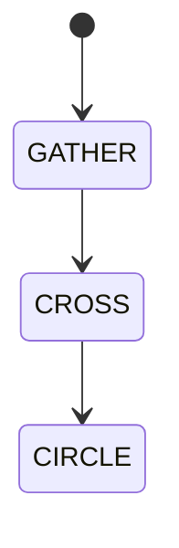

# Swarm behaviours

!!! warning "Experimental"
    This is a [study in progress](index.md): its API will probably change.

A swarm behaviour is an aggregate function that returns where a robot moves: a
`Vector`, a velocity or a heading. Behaviours are summed and weighted to compose new
ones, and the program stores the result as the `velocity` the robot moves by. The
blocks follow [*MacroSwarm: A Field-based Compositional Framework for Swarm
Programming*](https://arxiv.org/abs/2401.10969) (Aguzzi, Casadei, Viroli, LMCS 2025)
and its [ScaFi implementation](https://github.com/scafi/macro-swarm).

```python
from phyelds.experimental.swarm import Vector, go_to, separation, sink_at

velocity = (go_to(target) + separation(Vector(), within=1.0) * 2).normalize()
store("velocity", velocity)
```

To take a shape, see [formations](formations.md).

---

## Vectors, in the plane and in space

`Vector(x, y, z=0)` adds, subtracts and scales with the usual operators, and has `dot`,
`cross`, `length`, `normalize`, `limit` and `rotate` (around the vertical axis).
`Vector(*position)` is the vector of a position of two or three coordinates, and
`tuple(v)` its components. A planar swarm leaves `z` at zero, so the same blocks move
robots on the ground and drones in the air: those that draw a direction, as `brownian`,
take `dimensions=3` to draw it in space.

Vectors travel in messages, so they can be shared with `neighbors` and spread.

---

## Moving the robots

The program stores the velocity; whoever runs it moves the robot. In the
[simulator](../simulator.md), `follow_velocity` moves a node by the velocity its
program stores, in any dimension, capped at `max_speed`:

```python
from phyelds.simulator.actions import follow_velocity

for node in simulator.environment.nodes.values():
    simulator.schedule_event(0.5, follow_velocity, simulator, 1.0, node, max_speed=0.2)
```

On a robot, read the `velocity` output after each round, as from
[Webots](../integration/webots.md) or [Mesa](../integration/mesa.md), and drive the
motors with it.

---

## The blocks

### Movement: `phyelds.experimental.swarm.movement`

| Block | Moves the robot |
| --- | --- |
| `stand_still()` | Nowhere: zero |
| `brownian(scale=1.0, *, dimensions=2)` | In a random direction, of length `scale` |
| `go_to(target, speed=1.0)` | Towards `target`; zero once on it. `is_close(target, distance)` tells whether it got there |
| `explore(minimum, maximum, speed=1.0)` | Towards a random goal in a box, a new one once reached |
| `maintain_trajectory(velocity, period)` | As `velocity()` drew, drawing again every `period` |
| `maintain_until(velocity, condition)` | As `velocity`, until `condition` holds |
| `avoid_obstacles(obstacles, min_distance)` | Away from the obstacles closer than `min_distance`, given as vectors to them |
| `neighbors_vectors(position=None)` | The field of the vectors from the robot to each neighbor |

The blocks that need to know where the robot is (`go_to`, `is_close`, `explore`,
`neighbors_vectors`) read the `position` sensor.

### Flocking: `phyelds.experimental.swarm.flocking`

| Block | Steers the robot |
| --- | --- |
| `separation(velocity, *, within=None, nearest=None)` | Away from its neighbors |
| `alignment(velocity, ...)` | As its neighbors move |
| `cohesion(velocity, ...)` | Towards its neighbors |
| `reynolds(velocity, *, vision, separation_within, ...)` | The boids: the three above, weighted, plus `velocity` |
| `vicsek(velocity, *, alpha=0.1, noise=0.1, ...)` | Towards the mean velocity, with some noise |
| `cucker_smale(velocity, strength, *, noise=0.1, ...)` | Towards the velocity of each neighbor, the more the closer |

Each takes the velocity of the robot in the previous round, as the models iterate on
velocities; remember it across rounds:

```python
from phyelds.calculus import remember_and_evolve

velocity = remember_and_evolve(Vector(), lambda previous: vicsek(previous.value)).value
```

`separation`, `alignment` and `cohesion` return a steering, the heading minus
`velocity`: pass `Vector()` to get the bare heading. `within` and `nearest` restrict the
neighbors a block looks at, as the queries of MacroSwarm: to those closer than a
distance, or to the closest few.

### Leaders and teams: `phyelds.experimental.swarm.leader`

A leader is a Boolean field: chosen, sensed or elected. Each robot follows the nearest
leader, along the network.

| Block | Does |
| --- | --- |
| `sink_at(leader)` | Heads to the leader, along the shortest path |
| `spin_around(center)` | Turns clockwise around the center |
| `align_with_leader(leader, velocity)` | Moves as the leader: its `velocity`, spread |
| `team_formation(intra, extra, *, condition=..., leader=None)` | Splits the swarm in teams around elected leaders, gathering them until `condition` holds; returns a `Team` |
| `Team.inside(behaviour)` | Runs `behaviour(leader)` in each formed team, apart from the others |
| `is_team_formed(leader, target_distance)` | Whether every member has its closest neighbor within `target_distance` |
| `cast_along(source, value, step)` | Spreads `value` along the shortest paths, changing it by the vector to each neighbor on the way |

Every robot must run a leader block, the leader too, since the leader is the source the
others follow: compute it outside the branches that tell the leader apart.

---

## Example: a mission

A swarm gathers around its leader, crosses the field with it, then turns around it. The
phases are a [collective state machine](state-machines.md): only the leader senses when
to go on, and the machine spreads each phase to the swarm. In each phase, the blocks
say how a drone moves.



```python
--8<-- "swarm.py:swarm"
```

{ width="480" }
{ width="480" }

Blue is *gather*, orange *cross*, green *circle*. The complete example is
[`docs/examples/swarm.py`](https://github.com/phyelds/phyelds/blob/master/docs/examples/swarm.py).

---

## What is not here

MacroSwarm also has formations by slots around a leader (`line`, `centeredCircle`,
`vShape`): they are not ported, since [formations on shapes](formations.md) take any
shape and recover from what disturbs them. Its plans, sequences of behaviours each
ending on a condition, are [collective state machines](state-machines.md) here, as in
the example above.
