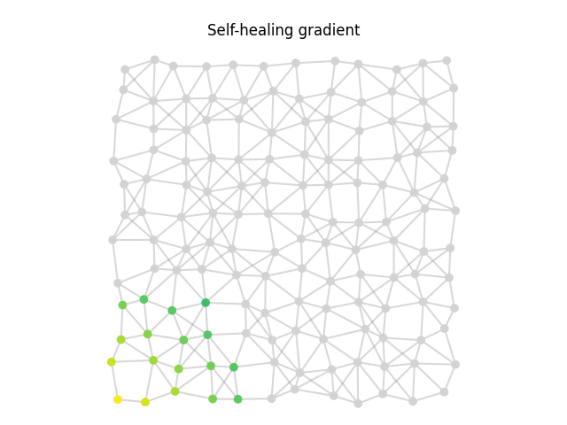

# phyelds

**phyelds** is a lightweight, pythonic toolkit for *aggregate computing*: you write
one program that describes the behaviour of a whole collective (a swarm of robots,
a sensor network, a fleet of devices), and every device runs it, exchanging values
only with its neighbors.

```bash
pip install phyelds             # core library and simulator
pip install "phyelds[jupyter]"  # optional: live rendering inside Jupyter
pip install phyelds-vmas        # optional: VMAS multi-robot integration
```

phyelds requires Python 3.12 or later.

## Where to start

<div class="grid cards" markdown>

- **[Playground](playground/index.md)**: write and run aggregate programs in
  your browser, with nothing to install.
- **[Tutorial](tutorial.md)**: build the gradient, the "hello world" of aggregate
  computing, step by step, and watch it converge and heal.
- **[Concepts](concepts/aggregate-programs.md)**: fields, rounds, `remember`,
  `neighbors`, alignment, and the bundled libraries.
- **[Simulator](simulator.md)**: deployments, neighborhoods, monitors, animations
  and CSV export.
- **[Integration](integration/index.md)**: run phyelds programs inside your own
  simulator, robot, or runtime.
- **[Pitfalls](pitfalls.md)**: what *not* to do, each with a fix.
- **[API reference](reference/calculus.md)**: generated from the docstrings.

</div>

## A taste

```python
from phyelds.calculus import aggregate, neighbors, remember

@aggregate
def hop_gradient(source: bool) -> float:
    set_distance, distance = remember(float("inf"))
    through_neighbors = neighbors(distance) + 1
    nearest = min(through_neighbors.exclude_self().values(), default=float("inf"))
    set_distance(0 if source else nearest)
    return distance
```

Every device runs these few lines; together, they compute the distance of every
device from the nearest source, and keep it correct while the network changes.

{ width="480" }

[Try it in the playground](playground/index.md#example=self_healing){ .md-button }
