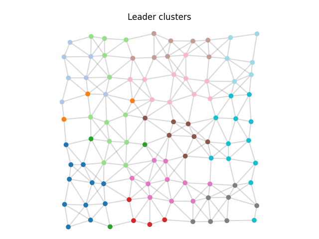
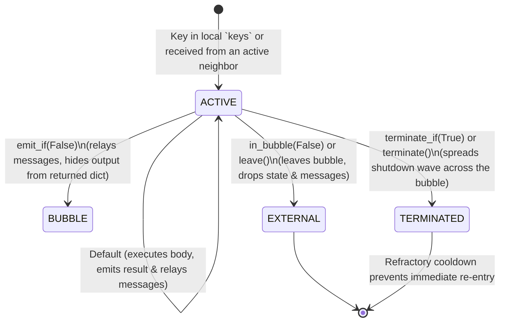
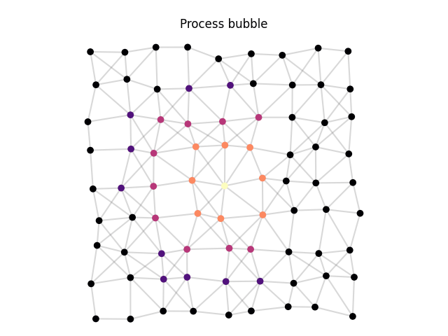

# Leader election & aggregate processes

This page covers self-organizing symmetry breaking (**Leader Election**, the `S` block) and dynamic, spatially/temporally scoped computations (**Aggregate Processes**, `@process` / `spawn`).

---

## Leader election: `phyelds.libraries.leader_election`

Leader election (`S` — *Sparse Choice*) breaks symmetry across a homogeneous network, electing a set of leaders spaced roughly `area` distance units apart.

| Function | Returns |
| --- | --- |
| `elect_leader(area, distances=None, *, strategy=None)` | The node ID of the leader elected for this device's region |
| `elect_leaders(area, distances=None, *, strategy=None)` | `True` on devices elected as regional leaders, `False` on followers |

`area` must be a finite positive bound: it defines the competition radius of each leader so that candidacies of disappeared leaders expire and the election remains self-stabilizing.

### Election strategies

- **`uuid_competition()`** *(default)*: breaks symmetry using random UUIDs propagated over a bounded gradient.
- **`candidacy(strength=None)`**: deterministic, priority-based bounded election (from FCPP / ACSOS 2022) with loop-free path validation. By default, lower `(strength, local_id())` wins; pass a custom `strength` metric (such as negative battery level) to prefer stronger candidates.

### Partitioning the network into Voronoi clusters (`S → G`)

Pairing `elect_leaders` (`S`) with `broadcast` (`G`) partitions the entire network into self-healing Voronoi regions centered on the elected leaders:

```python
from phyelds.calculus import aggregate
from phyelds.libraries.device import local_id
from phyelds.libraries.distances import neighbors_distances
from phyelds.libraries.leader_election import candidacy, elect_leaders
from phyelds.libraries.spreading import broadcast

@aggregate
def cluster_id(grain: float = 4.5) -> int:
    distances = neighbors_distances()
    is_leader = elect_leaders(grain, distances, strategy=candidacy())
    return broadcast(is_leader, local_id(), distances)
```

{ width="480" }

[Run leader clusters in the playground](../playground/index.md#example=leaders){ .md-button }

---

## Aggregate processes: `phyelds.libraries.processes` { #aggregate-processes-phyeldslibrariesprocesses }

Standard `@aggregate` functions run a single global field across the network. **Aggregate processes** (inspired by ScaFi's `spawn`) let any device dynamically start **multiple concurrent, spatially and temporally bounded field computations**—called **bubbles**—identified by arbitrary keys (such as an event ID, a target ID, or a user request).

### How a process bubble works

Decorate a function with `@process` and launch instances with `fn.spawn(keys, *args, **kwargs)` (or `spawn(fn, keys, *args, **kwargs)`), where `keys` is the `set` of process keys generated locally on this device in the current round.

Each active bubble instance goes through four lifecycle states on each node:



### Controlling bubble scope and termination

Inside a `@process` function, you return normal Python values and control the bubble's spatial boundary and lifetime with guard functions or the `bubble` context manager:

| Construct | Meaning |
| --- | --- |
| `in_bubble(condition)` / `leave()` | Keeps the device inside the bubble while `condition` is `True`; when `False`, exits immediately (`EXTERNAL`), discarding state and messages |
| `terminate_if(condition)` / `terminate()` | Triggers a refractory termination wave that cleanly shuts down the entire bubble across all participating nodes (`TERMINATED`) |
| `emit_if(condition)` | When `False`, the device still participates as an internal relay (`BUBBLE`) but omits its entry from the dictionary returned by `spawn` |
| `with bubble(inside=..., terminate=..., emit=...):` | Context manager combining `terminate_if`, `in_bubble`, and `emit_if` |

```python
from phyelds.calculus import aggregate
from phyelds.libraries.collect import count_nodes
from phyelds.libraries.device import local_id, sense
from phyelds.libraries.processes import in_bubble, process, terminate_if
from phyelds.libraries.spreading import broadcast, distance_to

@process
def alert_bubble(origin_id: int, max_hops: float = 3.0) -> int:
    is_origin = local_id() == origin_id
    dist = float(distance_to(is_origin))
    terminate_if(is_origin and sense("clear"))   # (1)!
    in_bubble(dist <= max_hops)                  # (2)!
    # Only devices within max_hops of origin_id execute the lines below
    return int(broadcast(is_origin, count_nodes(dist)))

@aggregate
def program() -> dict[int, int]:
    new_alerts = {local_id()} if sense("alarm") else set()
    return alert_bubble.spawn(new_alerts, max_hops=3.0)
```

1. When the origin device senses `"clear"`, a termination wave shuts down the entire `origin_id` bubble across the network.
2. Devices farther than `max_hops` hops immediately leave the bubble (`EXTERNAL`) and do not execute or relay the process further.

{ width="480" }

[Run process bubbles in the playground](../playground/index.md#example=bubbles){ .md-button }
