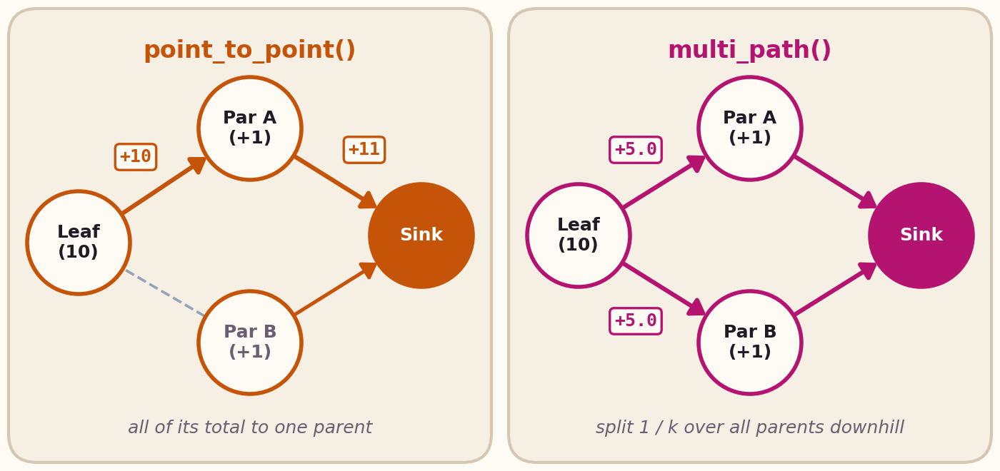

# Spreading, collection & gossip

This page covers the core spatial propagation libraries: **Spreading (`G`)**, **Collection (`C`)**, and **Gossip**.

---

## Spreading: `phyelds.libraries.spreading`

Spreading functions propagate distances and data **outward** from one or more `source` devices (where `source` is `True`).

| Function | Returns |
| --- | --- |
| `distance_to(source, distances=None, *, strategy=None)` | The gradient: shortest distance from the nearest device where `source` is `True` |
| `broadcast(source, data, distances=None, *, strategy=None)` | The `data` of the nearest `source`, propagated outward along the gradient |
| `cast_from(source, data, accumulation, distances=None, *, strategy=None)` | Like `broadcast`, applying `accumulation(current, step_dist)` at each hop |
| `distance_between(source, target, distances=None, *, strategy=None)` | The shortest distance between `source` and `target`, broadcast across the network |
| `channel(source, target, width=0.0, distances=None, *, strategy=None)` | `True` on devices on a route from `source` to `target` at most `width` longer than the shortest one |

When `distances` is omitted, `hops_distance()` (1 per hop) is used; pass `neighbors_distances()` for metric Euclidean distances.

### Choosing a spreading strategy: `bellman_ford` vs. `path_coherent`

All spreading functions accept a pluggable `strategy`:

- **`bellman_ford()`** *(default)*: classic Bellman-Ford relaxation using `remember` and `neighbors`. Lightweight, but suffers from the *rising-value problem* when all sources disappear or jump far away (stale low estimates slowly count up).
- **`path_coherent(max_diameter=...)`**: fast self-healing gradient built on [`exchange`](../concepts/neighborhood-field.md#exchange) and loop-free `PathValue` routes. When a source disappears, any route that previously depended on it is invalidated immediately instead of looping through neighbors.

```python
from phyelds.calculus import aggregate
from phyelds.libraries.device import local_id, sense
from phyelds.libraries.distances import neighbors_distances
from phyelds.libraries.spreading import broadcast, path_coherent

@aggregate
def nearest_station_id():
    # Every device learns the ID of the nearest station via a fast self-healing gradient
    return broadcast(
        sense("is_station"),
        local_id(),
        neighbors_distances(),
        strategy=path_coherent(max_diameter=20),
    )
```

---

## Collection: `phyelds.libraries.collect`

Collection (`C`) is the dual of spreading: values flow **inward** (downhill along a `potential` field, such as a gradient) toward the source(s), accumulating along the way.

| Function | Returns (at the sink: aggregated over the whole basin) |
| --- | --- |
| `find_parent(potential)` | The ID of the neighbor with the lowest `potential` (`None` at a local minimum) |
| `find_parents(potential, predicate=None)` | The `set` of all neighbor IDs whose `potential` is strictly lower than the device's own |
| `collect_with(potential, local, accumulation, *, strategy=None)` | `local` values accumulated downhill with `accumulation(a, b)` |
| `count_nodes(potential, *, strategy=None)` | Total number of devices in the basin |
| `sum_values(potential, local, *, strategy=None)` | Sum of `local` over all devices in the basin |
| `mean_values(potential, local, *, strategy=None)` | Arithmetic mean of `local` over all devices in the basin |
| `collect_or(potential, local, *, strategy=None)` | `True` on nodes whose subtree contains at least one device with `local == True` |
| `summarize(sink, local, accumulation, distances=None, ...)` | Collects `local` into `sink` and broadcasts the aggregated result back to all devices (`G → C → G`) |

### Choosing a collection strategy

Collection functions support three pluggable routing strategies:



- **`broadcast_collect()`** *(default)*: each node selects its single best parent (`find_parent(potential)`) and advertises `(parent_id, total)` via `neighbors`.
- **`point_to_point()`**: uses an anisotropic [`exchange`](../concepts/neighborhood-field.md#exchange) so each device sends its accumulated total **only** to its selected parent and `identity` to everyone else.
- **`multi_path()`**: builds a Directed Acyclic Graph (DAG) toward all downhill neighbors (`find_parents(potential)`) and splits each node's value equally (`1 / len(parents)`) across all parents using `divider`. More resilient to link changes than a single spanning tree.

```python
from phyelds.calculus import aggregate
from phyelds.libraries.collect import count_nodes, point_to_point
from phyelds.libraries.device import sense
from phyelds.libraries.spreading import distance_to

@aggregate
def network_size():
    potential = distance_to(sense("source"))
    return count_nodes(potential, strategy=point_to_point())
```

### Combining spreading and collection: a corridor

A gradient towards a `target`, `collect_or` along it from a `source`, and a second gradient from the devices it marks create a self-healing corridor: the devices within `width` of the shortest path (the [tutorial](../tutorial.md#7-composing-blocks-building-a-channel) builds it step by step). Unlike `channel`, whose `width` is a slack on the length of the route (the [playground](../playground/index.md#example=channel) runs it term by term), here `width` is a distance from the path:

{ width="480" }
{ width="480" }

[Run the corridor in the playground](../playground/index.md#example=corridor){ .md-button }

---

## Gossip: `phyelds.libraries.gossip`

Gossip functions compute global extrema or consensus across the network **without** requiring a source or a gradient.

| Function | Returns |
| --- | --- |
| `gossip_min(value, *, key=None, strategy=None)` | The minimum of `value` across the network |
| `gossip_max(value, *, key=None, strategy=None)` | The maximum of `value` across the network |
| `gossip_mean(value)` | Iterative local neighborhood averaging of `value` |
| `gossip(value, callback, *, strategy=None)` | Combines `value` across the network using an associative, idempotent `callback` (e.g., `set.union`) |
| `any_node(condition, *, strategy=None)` | Whether `condition` holds on at least one device in the network |
| `stabilizing_gossip(value, max_diameter, callback)` | Hop-bounded gossip that forgets contributions farther than `max_diameter` hops |

### Choosing a gossip strategy

- **`monotonic_gossip()`** *(default)*: fast 1-state gossip (`remember` + `neighbors`). Note that monotonic gossip never forgets an extreme value (e.g., if the node holding the global minimum leaves, its minimum remains in the network).
- **`path_coherent_gossip(max_diameter=...)`**: spatial self-stabilizing gossip based on loop-free `PathValue` routes. Immediately adapts when values increase or devices leave.
- **`time_replicated_gossip(period, max_replicas=2)`**: temporal self-stabilizing gossip that runs overlapping time-windowed replicas and periodically discards obsolete values.
