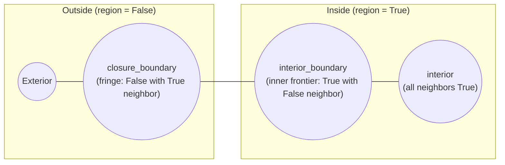

# Time, reactive state & logic

This page covers temporal/reactive signal processing (`phyelds.libraries.time`) and formal spatial/temporal property monitoring (`phyelds.libraries.logic`).

---

## Time & reactive state: `phyelds.libraries.time`

Real collective systems often need timers, synchronized clocks, edge detection, smoothing filters, and periodic state resets.

### Clocks, timers, and time replication

| Function | Returns |
| --- | --- |
| `local_time()` | Current timestamp of the device (`sense("time")`, default `0.0`) |
| `delta_time(clock=None)` | Elapsed time since the previous round on this device (`0.0` on round 1) |
| `shared_clock(clock=None)` | Monotonic network-wide clock synchronized via gossip to the fastest device |
| `timer(duration, *, periodic=False, clock=None)` | Countdown starting at `duration` and reaching `0.0` (auto-restarts when `periodic=True`) |
| `periodic_impulse(period, *, clock=None)` | `True` for a single round once every `period` time units |
| `recently_true(condition, duration, *, clock=None)` | `True` while `condition` holds and for `duration` time units after it becomes `False` |
| `time_replicated(process, period, *, max_replicas=2, clock=None)` | Runs `process` in overlapping time-windowed replicas so stale state is periodically discarded |

### Reactive state and signal operators

| Function | Returns |
| --- | --- |
| `delay(value, initial=None)` | The value `value` had on this device in the previous round (`initial` on round 1) |
| `has_changed(value, *, initially=False)` | `True` on rounds where `value != delay(value)` |
| `rising_edge(condition)` | `True` on the round where `condition` transitions `False → True` |
| `falling_edge(condition)` | `True` on the round where `condition` transitions `True → False` |
| `once(value)` | Returns `value` on the first round and `None` on every subsequent round |
| `exponential_filter(signal, alpha)` | Exponential moving average of `signal` with smoothing factor `alpha` in `[0, 1]` |
| `counter()` | Number of rounds this call site has executed (`1, 2, 3, ...`) |
| `decay(value, rate)` | Starts at `value` and decreases by `rate` each round down to `0` |

```python
from phyelds.calculus import aggregate
from phyelds.libraries.device import sense
from phyelds.libraries.time import exponential_filter, recently_true, rising_edge

@aggregate
def smoke_detector():
    smooth_temp = exponential_filter(sense("temperature"), alpha=0.3)
    spike = rising_edge(smooth_temp > 75.0)
    # Keep the alert active for 10.0 seconds after any temperature spike
    return recently_true(spike, duration=10.0)
```

---

## Spatial & temporal logic: `phyelds.libraries.logic`

`phyelds.libraries.logic` brings formal runtime verification directly into aggregate programs, implementing **Spatial Logic for Closure Spaces (SLCS)** and **Past Computation Tree Logic (Past-CTL)** (from FCPP).

### Spatial Logic for Closure Spaces (SLCS)

Given a boolean field `region` (where `True` marks nodes inside the region), SLCS operators classify the topological structure of the region and its reachability:



| Spatial operator (SLCS) | Returns |
| --- | --- |
| `interior(region)` | `True` on nodes in `region` whose neighbors are **all** in `region` |
| `closure(region)` | `True` on nodes that are in `region` or have **at least one** neighbor in `region` |
| `boundary(region)` | `closure(region) and not interior(region)` (both the inner and outer borders) |
| `interior_boundary(region)` | `region and not interior(region)` (nodes in `region` touching the outside) |
| `closure_boundary(region)` | `closure(region) and not region` (nodes outside `region` touching `region`) |
| `somewhere(condition, *, max_diameter=20.0, strategy=None)` | `True` if `condition` holds on at least one reachable device within `max_diameter` |
| `everywhere(condition, *, max_diameter=20.0, strategy=None)` | `True` if `condition` holds on all reachable devices within `max_diameter` |
| `reaches(region, target, *, max_diameter=20.0, strategy=None)` | `True` if a path staying entirely inside `region` reaches a `target` device |
| `touches(region, target, *, max_diameter=20.0, strategy=None)` | `True` on devices in `region` whose connected component is adjacent to a `target` |
| `surrounds(region, barrier, *, max_diameter=20.0, strategy=None)` | `True` on devices in `region` that are completely enclosed by `barrier` nodes |

```python
from phyelds.calculus import aggregate
from phyelds.libraries.device import sense
from phyelds.libraries.logic import interior_boundary, reaches

@aggregate
def safe_evacuation():
    safe_zone = not sense("hazard")
    can_reach_exit = reaches(safe_zone, sense("is_exit"), max_diameter=30.0)
    on_hazard_perimeter = interior_boundary(safe_zone)
    return can_reach_exit, on_hazard_perimeter
```

### Past Computation Tree Logic (Past-CTL)

Past-CTL operators evaluate temporal properties over a device's own execution history (`scope="local"`), across all aligned neighbors (`scope="all"`, universal past), or across any aligned neighbor (`scope="any"`, existential past / causal cone):

| Temporal operator (Past-CTL) | Returns (`scope="local" \| "all" \| "any"`) |
| --- | --- |
| `yesterday(condition, *, scope="local")` | Whether `condition` held in the previous round (locally, in all neighbors, or in any neighbor) |
| `since(sustained, triggered, *, scope="local")` | Whether `sustained` has held continuously since a round where `triggered` occurred |
| `previously(condition, *, scope="local")` | Whether `condition` held at least once in the past (`since(True, condition, scope=...)`) |
| `historically(condition, *, scope="local")` | Whether `condition` has held in every round so far (`not previously(not condition, scope=...)`) |
