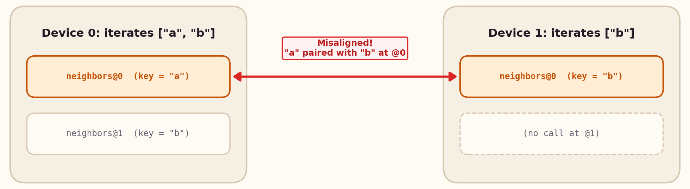

# Common pitfalls

**phyelds** programs are ordinary Python, so the Python interpreter will not stop you from writing code that violates the aggregate execution model. This page collects the mistakes that are easy to make, why they happen, and how to fix each one.

| Category | Pitfall | Fix |
| --- | --- | --- |
| **Alignment** | [Data-dependent loops](#a-data-dependent-number-of-aggregate-calls) | Share a `dict` in one `neighbors(...)` call, or use [`@process` / `spawn`](libraries/self-organisation.md#aggregate-processes-phyeldslibrariesprocesses) |
| **Alignment** | [Helpers without `@aggregate`](#helpers-without-aggregate) | Decorate every function that calls `remember`, `neighbors`, or `exchange` |
| **Alignment** | [`:=` in conditional expressions](#in-a-conditional-expression-does-not-split-the-network) | Move the assignment outside the ternary expression |
| **Alignment** | [Functions without source code](#aggregate-functions-without-source-code) | Define `@aggregate` functions in `.py` files or notebook cells |
| **State & Mutability** | [Mutating shared values](#mutating-shared-values) | Treat received neighbor values as read-only; prefer tuples/frozensets |
| **State & Mutability** | [Module-level global variables](#module-level-state) | Keep per-device state in `remember(...)`, never in mutable Python globals |
| **State & Mutability** | [`random()` or side effects per round](#random-values-and-other-per-round-surprises) | Wrap one-shot random choices in `remember(random.random())`; use `store(...)` for outputs |
| **State & Mutability** | [Storing `None` in `remember`](#storing-none) | Use a sentinel (`float("inf")`, `()`) because `None` resets state |
| **State & Mutability** | [State inside branches resets](#state-inside-branches-resets) | Move `remember` outside the `if` if the state must survive branch switches |
| **Fields & Dynamics** | [Sharing a `NeighborhoodField`](#sharing-a-field) | Share a scalar/tuple reduced from the field (`field.min()`, `field.local()`) |
| **Fields & Dynamics** | [Expecting instant answers](#expecting-instant-answers) | Let fields converge across rounds; use `path_coherent` to avoid the rising-value problem |
| **Simulator** | [Overwriting `node.data`](#editing-node-data-in-the-simulator) | Mutate keys (`node.data["source"] = True`) instead of replacing the dict |

---

## A data-dependent number of aggregate calls

Calls are aligned by their sequential position (`@0`, `@1`, `@2`, …). Inside a loop, the *i*-th iteration on one device is aligned with the *i*-th iteration on its neighbors, regardless of what elements they are iterating over.



```python
# ❌ device 0 iterates over ["a", "b"], the others over ["b"]:
#    device 0's "a" exchange receives the others' "b" values
@aggregate
def program():
    seen = {}
    for key in my_keys():
        seen[key] = neighbors(value_of(key))
    return seen
```

Wrapping the body in `with align(key):` does **not** fix it: the call index is still part of the path. Instead, either share a single dictionary, iterate over a fixed sequence known to all devices, or spawn dynamic [`@process` bubbles](libraries/self-organisation.md#aggregate-processes-phyeldslibrariesprocesses):

```python
# ✅ Option 1: one exchange — share a dictionary, then pick from it
@aggregate
def program():
    mine = {key: value_of(key) for key in my_keys()}
    field = neighbors(mine)
    return {
        key: [values[key] for values in field.data.values() if key in values]
        for key in mine
    }

# ✅ Option 2: the exact same sequence on every device
ALL_KEYS = ["a", "b"]

@aggregate
def program():
    seen = {}
    for key in ALL_KEYS:
        values = neighbors(value_of(key) if key in my_keys() else None)
        if key in my_keys():
            seen[key] = [v for v in values if v is not None]
    return seen
```

The same rule holds for list/dict comprehensions, `map`, and recursion.

---

## `:=` in a conditional expression does not split the network

`@aggregate` aligns the branches of a conditional expression (`a if cond else b`) by lifting them into lambdas. A branch with `:=` (or `yield`, `await`) would change variable scope inside a lambda, so it is left untouched and its two branches remain in the same alignment scope:

```python
# ❌ the := keeps both branches together: robots and sensors hear each other
values = (heard := neighbors("robot")) if sense("is_robot") else neighbors("sensor")

# ✅ assign outside the conditional expression
heard = neighbors("robot") if sense("is_robot") else neighbors("sensor")
```

---

## Helpers without `@aggregate`

A plain Python function called from an `@aggregate` function shares its caller's alignment frame, and its `if` statements are **not** rewritten to split the network:

```python
# ❌ the branches of `pick` are not separated
def pick(flag):
    if flag:
        return neighbors("left")
    return neighbors("right")

# ✅ decorate every function that (directly or indirectly) calls remember, neighbors, or exchange
@aggregate
def pick(flag):
    if flag:
        return neighbors("left")
    return neighbors("right")
```

---

## Aggregate functions without source code

`@aggregate` inspects the source code of the function to rewrite its AST. In code built dynamically with `exec`, `python -c`, or the standard interactive REPL, source code is unavailable: phyelds prints `WARNING: AST transformation failed` and runs the function without `if` branch rewriting. Define `@aggregate` functions in `.py` files or Jupyter notebook cells.

---

## Mutating shared values

In the bundled simulator, values are delivered by reference: the list a neighbor shared *is* that neighbor's state object. Mutating it silently alters another device's memory:

```python
# ❌ appends directly to the neighbors' remembered lists
for other in neighbors(items.value).exclude_self().values():
    other.append(item)

# ✅ build a new immutable value instead
received = neighbors(items.value).exclude_self().values()
set_items(tuple({*items.value, *(x for other in received for x in other)}))
```

Prefer immutable types (`tuple`, `frozenset`, frozen `dataclass`) in `remember` and `neighbors`. Real-network runtimes serialize messages anyway, so code that relies on shared references only works by accident in the simulator.

---

## Module-level state

All simulated devices run inside the same Python process, so a module-level variable is shared by every device—creating a hidden global channel that would not exist on real distributed nodes:

```python
# ❌ all devices append to the same global list
seen = []

@aggregate
def program():
    seen.append(local_id())

# ✅ per-device state belongs in remember
@aggregate
def program():
    set_seen, seen = remember(())
    set_seen((*seen, local_id()))
```

Module-level constants (`INFINITY = float("inf")`) are fine; mutable globals are not.

---

## Random values and other per-round surprises

Because the program runs from the top at every round, calling `random.random()` directly produces a **new** random number in every round. If a device needs a stable random value (such as a tie-breaking UUID or priority), store it in `remember`:

```python
_, priority = remember(random.random())   # drawn in round 1, remembered afterwards
```

The same applies to side effects: `print(...)`, logging, and file I/O execute on every device in every round. To expose a result to the outside world or simulator monitors, write it with `store(name, value)`.

---

## Storing `None`

In `remember`, `None` means "no state": after `set_value(None)`, the next round `remember` returns its `initial` value again. Use a dedicated sentinel (`float("inf")`, `()`, or a custom object) to represent "no value yet".

---

## State inside branches resets

State that is not read during a round is dropped at the end of that round. Consequently, a `remember` inside an `if` branch starts back from its `initial` value whenever the device leaves the branch and re-enters it later. This is the intended field-calculus semantics (entering a branch starts a fresh domain computation); if the state must persist across branch switches, call `remember` *before* the `if`.

---

## Sharing a field

Calling `neighbors(field)` raises `TypeError`: a `NeighborhoodField` only makes sense relative to the device that built it. Share a plain value computed from the field instead (`field.min()`, `field.local()`, `field.exclude_self()`).

---

## Expecting instant answers

A computational field is not computed in a single round: information travels one hop per round, so convergence time scales with the network diameter. Always allow enough rounds for the field to settle, and design actuators to tolerate transient values.

Some classic algorithms also converge asymmetrically. The Bellman-Ford gradient lowers its distance estimates quickly (*good news travels fast*), but raises them slowly when a source disappears because neighbors keep leaning on each other's slightly smaller stale estimates (the **rising-value problem**; see the [tutorial](tutorial.md#6-self-healing)). When sources can disappear or move rapidly, pass `strategy=path_coherent(max_diameter=...)` to `distance_to` or `broadcast`.

---

## Editing node data in the simulator

Calling `node.update(new_data=...)` replaces the node's entire `data` dictionary, wiping out the runner's `state` and `messages` keys. To update a single sensor during a simulation, assign the dictionary key directly:

```python
node.data["source"] = True
```
