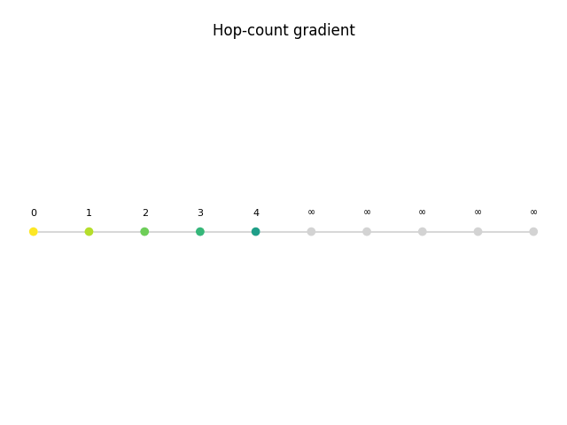
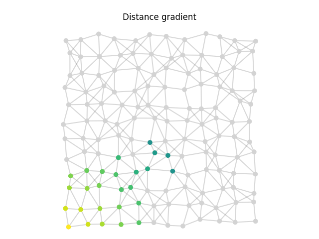

# Tutorial: the gradient

The *gradient* is a field in which every device holds its distance from the
nearest *source*. It needs nothing but local state and neighbor exchanges, yet it
has a global meaning, and it is the building block of most other patterns:
[`broadcast`, `collect_with` and `elect_leaders`](concepts/libraries.md) are all
built on top of it.

The complete code, including the script that produced the animations, is in
[`docs/examples/gradient.py`](https://github.com/phyelds/phyelds/blob/master/docs/examples/gradient.py).

## 1. Each device remembers its estimate

A device cannot know its distance in one shot: it keeps an estimate and refines it
at every round. State that survives across rounds is [`remember`](concepts/state.md)
(the `rep` of field calculus). Before knowing anything, the estimate is infinity:

```python
set_distance, distance = remember(float("inf"))
```

## 2. Look at the neighbors' estimates

[`neighbors(distance)`](concepts/neighborhood-field.md) sends the local estimate to
the neighbors and returns a `NeighborhoodField`: one value per neighbor, plus the
device itself. Arithmetic on fields is element-wise, so `+ 1` adds one hop to each
neighbor's estimate, giving the distance *through* that neighbor:

```python
through_neighbors = neighbors(distance) + 1
```

## 3. Keep the best one

A source is at distance 0; any other device takes the shortest path its neighbors
offer. `exclude_self()` drops the device's own entry, so that it cannot lean on
itself:

```python
--8<-- "gradient.py:hop_gradient"
```

Read *locally*, it compares a few numbers. Read *globally*, it is a distributed
shortest-path algorithm: round after round the correct distances spread from the
source, until the whole network holds its hop count.

{ width="640" }

!!! note "Why does the wave move more than one hop per round?"
    In the phyelds simulator the devices of one round run one after the other and
    read the freshest messages of the neighbors that already ran. The final field
    does not depend on that order; only the speed does.

## 4. Run it

Every device runs the *same* program, and reads whether it is a source from a
sensor. The [simulator](simulator.md) provides the deployment, the neighborhood
relation and the scheduling:

```python
from phyelds.calculus import aggregate
from phyelds.libraries.device import sense
from phyelds.simulator import Simulator
from phyelds.simulator.deployments import grid_generation
from phyelds.simulator.neighborhood import radius_neighborhood
from phyelds.simulator.runner import schedule_program_for_all

@aggregate
def program():
    return hop_gradient(sense("source"))

simulator = Simulator()
grid_generation(simulator, width=10, height=1, spacing=1.0)   # a line of 10 devices
simulator.environment.set_neighborhood_function(radius_neighborhood(1.1))
simulator.environment.add_data_for_all_nodes({"source": False})
simulator.environment.nodes[0].data["source"] = True          # device 0 is the source

schedule_program_for_all(simulator, start=0.0, frequency=1.0, program=program)
simulator.run(12)
print([node.data["result"] for node in simulator.environment.nodes.values()])
# [0, 1, 2, 3, 4, 5, 6, 7, 8, 9]
```

## 5. From hops to distances

Replacing the constant `1` with the measured distance to each neighbor gives a
metric gradient. That is what the library `distance_to` does:

```python
from phyelds.libraries.distances import neighbors_distances
from phyelds.libraries.spreading import distance_to

@aggregate
def program():
    return distance_to(sense("source"), neighbors_distances())
```

{ width="480" }

## 6. Self-healing

Nothing in the program refers to *when* the source appeared or *where* it is:
every round recomputes the field from the current state of the network. When the
source jumps to the opposite corner, the field repairs itself with no extra code.

{ width="480" }

The area around the new source settles quickly; the old one is slower, because its
devices can only raise their stale, too-small estimates a little at a time, leaning
on each other. This is the *rising value problem* of the classic gradient: see
[Pitfalls](pitfalls.md#expecting-instant-answers).

## Where next

- [Aggregate programs](concepts/aggregate-programs.md): the execution model behind
  what you just ran.
- [Libraries](concepts/libraries.md): broadcast, collection, gossip and leader
  election, all built on gradients.
